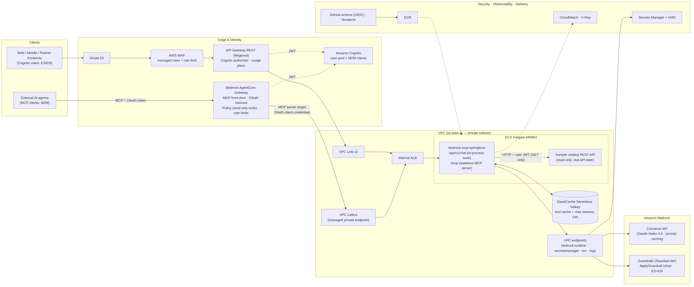

# bedrock-mcp-springboot

Natural-language gateway **and** MCP server over a Spring Boot REST API, powered by **Amazon Bedrock** (Converse +
tool use) and protected by **Amazon Bedrock Guardrails**. Runs locally with **Floci** (AWS emulator) and deploys to
AWS **ECS Fargate** behind **API Gateway**.

`Java 25 · Spring Boot 4.1.2 · Spring AI 2.0.2 · AWS SDK 2.55.14 · Maven · Docker · Floci · Valkey`



> 📌 Architecture: [`docs/architecture`](docs/architecture/architecture.md)
> (+ [draw.io](docs/architecture/architecture.drawio)) · Decisions: [`docs/adr`](docs/adr)

## What you get
| Endpoint | Purpose |
|---|---|
| `POST /api/v1/chat` | Natural language → Guardrail (input) → Claude on Bedrock → tools → REST API → Guardrail (output) |
| `POST /mcp` | MCP server (Streamable HTTP, stateless) exposing `search_products`, `get_product`, `create_order` |
| `GET/POST /api/v1/products, /orders` | Sample business REST API (replace with yours) |
| `/actuator/health/{liveness,readiness}` | Probes for ECS/ALB |

## Prerequisites
- JDK 25, Docker Desktop (Compose v2)
- For real AI locally: AWS CLI v2 + IAM Identity Center access to a dev account with Bedrock model access
  ([runbook](docs/runbooks/aws-sso-setup.md)). Without AWS: use the offline profile (Ollama).

## Run locally — option A: IntelliJ + real Bedrock (recommended)
```bash
docker compose up -d                          # Floci :4566 (+ seeds secret) and Valkey :6379
aws sso login --profile bedrock-dev           # IAM Identity Center, no access keys
```
IntelliJ: *File → Open → pom.xml (as project)*. Run `BedrockMcpApplication` with
- Active profiles: `local`
- Environment: `AWS_PROFILE=bedrock-dev` (optional: `GUARDRAIL_MODE=BEDROCK;GUARDRAIL_ID=<id>`)

or from a terminal:
```bash
./mvnw spring-boot:run -Dspring-boot.run.profiles=local          # Windows: mvnw.cmd ...
```
Then open [`docs/api/requests.http`](docs/api/requests.http).

## Option B: everything in containers
```bash
cp .env.example .env                          # set AWS_PROFILE (and AWS_DIR on Windows)
./scripts/docker-build.sh                     # -> bedrock-mcp-springboot:0.1.0   (PowerShell: .\scripts\docker-build.ps1)
docker compose --profile app up -d            # container name: bedrock-mcp-springboot
```

## Option C: fully offline (no AWS account)
```bash
docker compose --profile offline up -d
docker exec ollama ollama pull qwen3:8b
SPRING_PROFILES_ACTIVE=local,local-offline ./mvnw spring-boot:run
```

## Option D: Floci Bedrock stub (CI wiring tests)
`SPRING_PROFILES_ACTIVE=local,floci-bedrock` — Bedrock calls go to Floci (fixed answer, no tool use). Set
`FLOCI_BEDROCK_BACKEND=proxy` to forward Converse to Ollama's OpenAI-compatible API.

## Profiles
| Profile | LLM | Guardrail | Secrets | AWS identity |
|---|---|---|---|---|
| `local` | real Bedrock | LOCAL or BEDROCK | Floci | IAM Identity Center profile |
| `local,local-offline` | Ollama | LOCAL | Floci | none |
| `local,floci-bedrock` | Floci stub | LOCAL | Floci | none |
| `qa`, `prod` | Bedrock (VPC endpoint) | BEDROCK (numbered version) | ECS secrets → env | ECS task role |

## QA / PROD connection to AWS — the short answer
- **No keys.** The ECS **task role** gives the container temporary credentials automatically
  (`credentials-mode: DEFAULT`). Least-privilege policy: Bedrock model/inference-profile ARNs, guardrail ARN, app secret.
- Application secrets: Secrets Manager → task definition `secrets` → env vars.
- CI/CD: GitHub Actions **OIDC** → per-environment deploy role. Humans: IAM Identity Center only.
- Separate AWS accounts per environment. See [ADR-0005](docs/adr/0005-aws-identity-and-credentials.md).

## Tests
```bash
./mvnw verify
```

## Project status
v0.1.0 generated on 2026-10-24. See [`docs/sessions/SESSION-LOG.md`](docs/sessions/SESSION-LOG.md) for what is verified.
