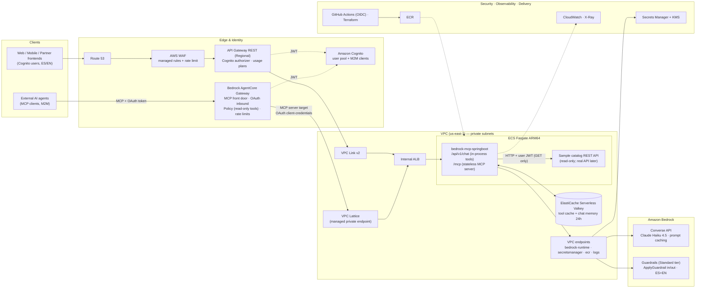
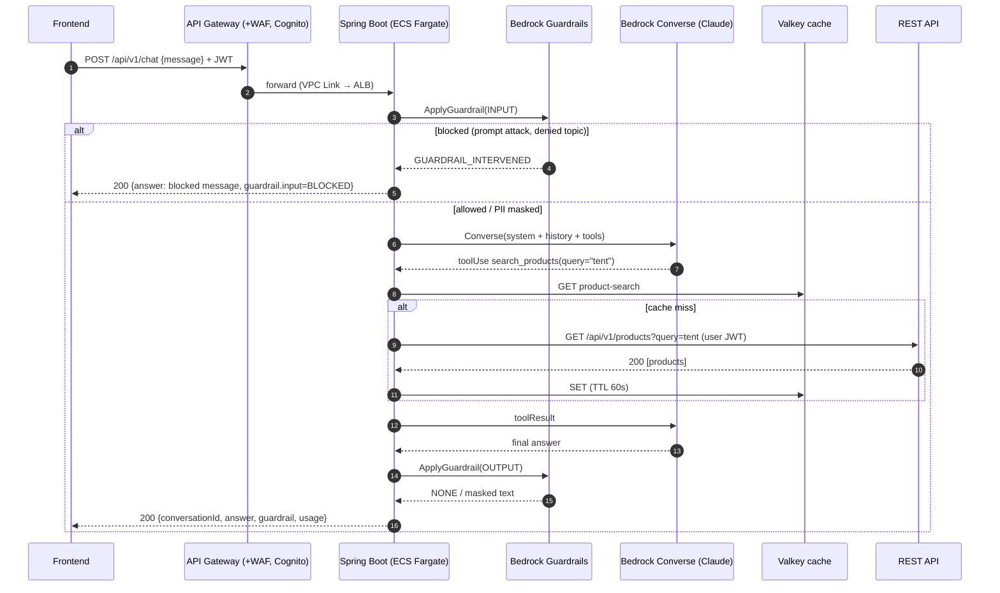
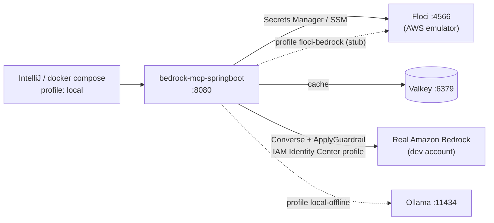

# Architecture — bedrock-mcp-springboot

> Status: **Target architecture v2 — decisions accepted by the owner** (ADR-0001…0009). Decisions are recorded in [`docs/adr`](../adr).
> Editable diagram: [`architecture.drawio`](architecture.drawio) (open in draw.io / diagrams.net → *File → Export as* PNG/SVG/PDF).

## 1. What the system does

1. A **frontend** (web, mobile, partner) sends a natural-language request: *"Do you have a 2-person tent under $400? Order one."*
2. **API Gateway** authenticates (Cognito JWT), throttles per client (usage plans) and filters attacks (WAF).
3. The **Spring Boot service** on ECS Fargate:
   1. screens the prompt with **Amazon Bedrock Guardrails** (`ApplyGuardrail`, source = INPUT),
   2. calls the **LLM** with Bedrock **Converse** + tool use (Claude Haiku 4.5 via cross-region inference profile),
   3. executes the **tools** the model chooses — each tool is a typed call to the **REST API**, with the end user's token,
   4. screens the answer with **Guardrails** (source = OUTPUT: PII masking, toxicity, denied topics),
   5. returns a stable JSON contract.
4. The same tools are published as an **MCP server** (`/mcp`, Streamable HTTP, *stateless*). External AI agents reach it through **Amazon Bedrock AgentCore Gateway** (OAuth, tool Policy, rate limits) — ADR-0009.
5. Release 1 is **read-only**: no write tools exist.

## 2. Target AWS architecture (QA / PROD)

## 3. Request sequence (chat)

## 4. Local environment

| Need | Local | QA / PROD |
|---|---|---|
| Secrets | Floci Secrets Manager (seeded by `floci-init`) | Secrets Manager → ECS `secrets` → env vars |
| Cache | Valkey container | ElastiCache Serverless for Valkey |
| LLM | Real Bedrock via SSO **or** Ollama offline **or** Floci stub | Bedrock via VPC endpoint |
| Guardrails | `LOCAL` (regex/denylist) or real Bedrock Guardrail | Bedrock Guardrail, numbered version |
| Identity | `aws sso login` (IAM Identity Center) | ECS task role (no secrets) |
| Auth | disabled | Cognito JWT at API Gateway **and** in the app |

## 5. Compute decision summary (see ADR-0002)

| Option | Verdict | Why |
|---|---|---|
| **ECS Fargate (ARM64)** | ✅ **Chosen** | Long-running LLM/tool loops (5–60 s), streaming-friendly, no cold starts for the JVM, private networking, simple ops, Graviton ≈ 20 % cheaper. |
| AWS Lambda (+SnapStart) | ❌ for this service | 29 s default API GW integration timeout, cold starts, MCP Streamable HTTP and tool loops fit poorly; good only for spiky, short calls. |
| App Runner | ❌ | Closed to new customers; AWS recommends ECS Express Mode instead. |
| ECS Express Mode | ⚠️ QA/sandbox only | Fast path (Fargate + ALB in one call) but it provisions its own public ALB; we need API Gateway + private ALB control. |
| EKS | ❌ (for now) | Operational overhead not justified for 1–3 services. |
| Bedrock AgentCore Runtime | ❌ | Built for agent code, not a REST/chat service. |
| Bedrock AgentCore **Gateway** | ✅ **Used** (ADR-0009) | Managed MCP front door for external agents; targets the Spring `/mcp`. Not used for `/chat`. |
